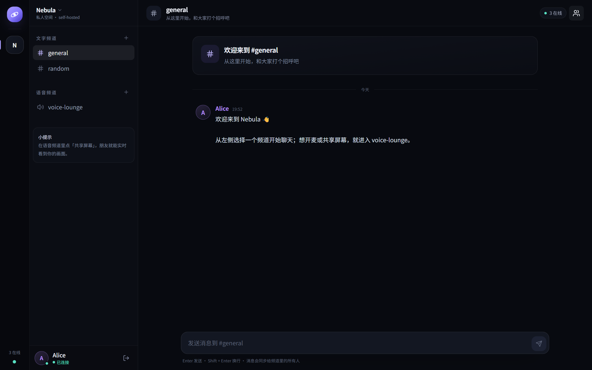
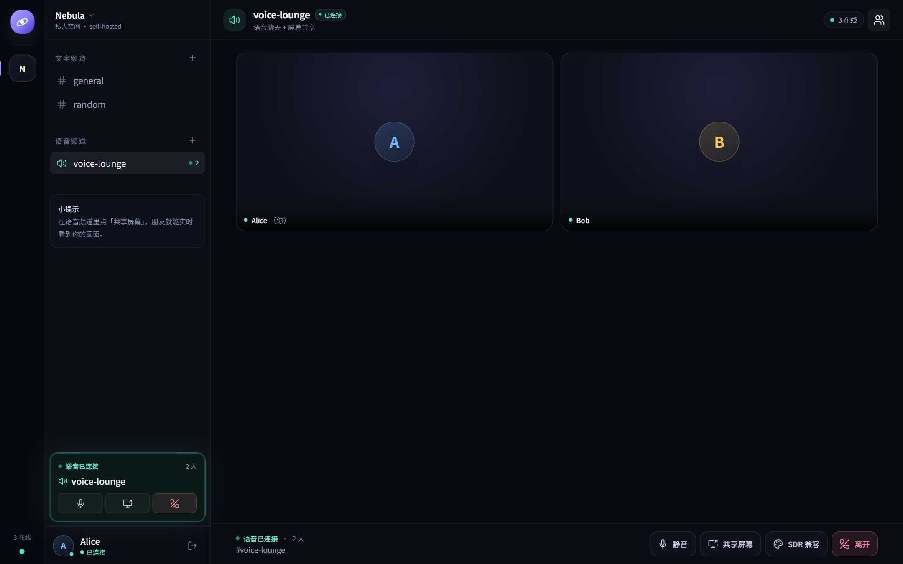

# Nebula

一个自托管的 Discord 风格聊天空间：账号登录、多频道文字聊天、实时消息、语音通话和一键屏幕共享。

技术栈：**Astro + React island + TypeScript + Tailwind CSS** · **FastAPI + SQLAlchemy + PostgreSQL** · **WebSocket + WebRTC** · **Electron（Windows 客户端）** · **Docker Compose + Caddy**。

| 文字频道 | 语音频道 |
| --- | --- |
|  |  |

---

## 功能

- 账号注册 / 登录（JWT + httpOnly Cookie）
- 单工作区、多文字频道 / 语音频道
- WebSocket 实时消息、在线状态、输入中提示、断线重连补消息
- 语音频道：麦克风通话、静音、参与者状态
- 屏幕共享：P2P mesh，支持同时共享画面与系统声音；HDR 屏幕会自动 tone map 到 SDR 以避免偏色
- 响应式深色 UI，桌面端三栏布局，小屏抽屉式侧栏
- Windows 桌面客户端：托盘、开机启动、全局快捷键、自定义屏幕源选择、自动更新
- 一条命令启动 PostgreSQL + API；开发环境由 Vite 代理 `/api` 与 `/ws`，生产环境由 Caddy 统一入口

> 语音与屏幕共享基于 P2P mesh，建议 **2–5 人**使用。需要跨公网稳定通话时请配置 TURN（见下文）。

---

## 快速开始（开发模式）

### 前置条件

- Node.js ≥ 22 与 pnpm
- Docker Desktop（含 Docker Compose）
- 可选：`uv`（本地跑测试 / Lint 时需要）

### 启动

```powershell
# 1. 可选：复制环境变量（不复制也能用默认开发配置）
Copy-Item .env.example .env

# 2. 起 PostgreSQL + FastAPI（首次会构建镜像并自动执行数据库迁移）
docker compose up -d --build

# 3. 装前端依赖
pnpm install

# 4. 起 Astro 开发服务器
pnpm dev
```

打开 <http://localhost:4321>。

首次启动会自动创建默认频道（#general、#random、语音频道 voice-lounge），并（`SEED_DEMO=true` 时）创建演示账号：

| 账号 | 密码 | 说明 |
| --- | --- | --- |
| `alice` | `nebula123` | 演示用户 A |
| `bob` | `nebula123` | 演示用户 B，适合双窗口测试 |

API 文档：<http://localhost:8000/docs>

### 服务端口

| 服务 | 端口 |
| --- | --- |
| Astro Web | 4321 |
| FastAPI | 8000 |
| PostgreSQL | 5432 |
| 生产 Caddy HTTP | 8080 |
| 生产 Caddy HTTPS | 8443（启用 HTTPS 时） |
| 开发 Caddy HTTPS（可选） | 9443 |

### 体验屏幕共享

1. 用普通窗口登录 `alice`，进入 **voice-lounge**，点击「加入语音频道」。
2. 用无痕窗口（或另一个浏览器）登录 `bob`，进入同一个语音频道。
3. 任一方点击「共享屏幕」，选择窗口或屏幕；另一方即可看到画面。
4. 浏览器必须允许麦克风 / 屏幕录制权限；`localhost` 属于安全来源，无需 HTTPS。
5. 如果共享 HDR 屏幕时颜色发灰或明显不对：停止共享，在语音控制栏打开 **「SDR 兼容」**，然后重新共享。检测到 HDR 显示器时应用会自动转换，这个开关用于兜底。

> 只用同一浏览器的两个标签页会共享登录 Cookie，两个标签都会是同一个账号。测试双向通话请使用普通窗口 + 无痕窗口，或两个浏览器。

### 开发环境局域网 HTTPS（可选）

`localhost` 本身就是安全来源，不需要这一步。如果想让手机 / 另一台电脑访问开发服务器并测试麦克风和屏幕共享：

1. 在 `.env` 中填入你电脑当前的局域网 IP（不要填 `localhost`）：

   ```env
   DEV_SITE_ADDRESS=https://192.168.1.23
   DEV_DEFAULT_SNI=192.168.1.23
   DEV_HTTPS_PORT=9443
   ```

2. 保持 `pnpm dev` 运行，启动 Caddy（只用一次即可）：

   ```powershell
   docker compose --profile https up -d
   ```

3. 信任 Caddy 的开发根证书：

   ```powershell
   docker compose exec -T caddy cat /data/caddy/pki/authorities/local/root.crt |
     Set-Content -Encoding ascii caddy-root.crt
   ```

   把 `caddy-root.crt` 安装到客户端系统的受信任根证书。

4. 访问 <https://192.168.1.23:9443>。

Caddy 会通过 `host.docker.internal:4321` 代理到宿主机的 Astro 开发服务器，HMR、`/api` 和 `/ws` 都可正常使用。普通开发模式仍然是 <http://localhost:4321>。不要把开发服务器暴露到公网。

---

## 架构

```text
浏览器
  ├─ HTTP  ──► Astro SSR (:4321) ──服务端 fetch──► FastAPI (:8000) ──► PostgreSQL
  └─ WS    ──► /ws（Vite / Caddy 代理）──► FastAPI：聊天广播、在线状态、WebRTC 信令
       └─ WebRTC P2P：麦克风音频 + 屏幕视频/系统音频，不经过服务器转发
```

- 消息发送走 REST，写入数据库后通过 WebSocket 广播；历史消息用游标分页加载。
- 语音/屏幕共享采用 **P2P mesh**：每个参与者与其他参与者建立一条 `RTCPeerConnection`。
- 提前协商好 3 条媒体线（麦克风、屏幕视频、屏幕音频），共享开始时用 `replaceTrack()` 切换，避免反复 SDP 重协商。
- 公网环境需要 TURN 才能穿透对称 NAT；本机与局域网通常直连即可。

### 目录

```text
.
├─ apps/
│  ├─ api/                    FastAPI 服务
│  │  ├─ app/
│  │  │  ├─ api/              auth / channels / messages / users / ws
│  │  │  ├─ realtime/hub.py   WS 连接、在线状态、语音房间、信令中转
│  │  │  ├─ models.py  schemas.py  security.py  seed.py
│  │  │  └─ main.py
│  │  ├─ alembic/             数据库迁移
│  │  └─ tests/               pytest（SQLite 内存库）
│  ├─ web/                    Astro 前端
│  │  └─ src/
│  │     ├─ components/app/   App / ChatView / VoiceStage / Sidebar ...
│  │     ├─ lib/              api / ws / store / rtc / screenCapture / desktop
│  │     ├─ pages/            login / register / channels/[channelId]
│  │     └─ middleware.ts     服务端鉴权与跳转
│  └─ desktop/                Electron Windows 客户端
│     ├─ src/main/            窗口 / 托盘 / 自启 / 快捷键 / 采集 / 更新
│     ├─ src/preload/         受控 IPC bridge
│     ├─ src/renderer/        设置 / 共享源选择器
│     └─ electron-builder.yml NSIS 打包配置
├─ deploy/Caddyfile           生产反向代理（HTTP/HTTPS + WebSocket）
├─ deploy/Caddyfile.dev       开发环境可选 HTTPS 入口
├─ .github/workflows/         Windows 安装包发布工作流
├─ docker-compose.yml         开发：db + api（+ 可选 caddy profile）
├─ docker-compose.prod.yml    生产：db + api + web + caddy
└─ pnpm-workspace.yaml
```

---

## 配置

### 根目录 `.env`（后端 / 部署）

| 变量 | 默认值 | 说明 |
| --- | --- | --- |
| `POSTGRES_DB` | `nebula` | 数据库名 |
| `POSTGRES_USER` | `nebula` | 数据库用户 |
| `POSTGRES_PASSWORD` | `nebula_dev_password` | 数据库密码，生产务必修改 |
| `JWT_SECRET` | 开发占位值 | JWT 签名密钥，生产必须设置为随机长字符串 |
| `JWT_EXPIRE_DAYS` | `7` | 登录有效期 |
| `SEED_DEMO` | `true`（开发）/ `false`（生产） | 是否创建 alice / bob 演示账号 |
| `COOKIE_SECURE` | `false` | 生产启用 HTTPS 后设为 `true` |
| `SITE_ADDRESS` | `:80` | Caddy 站点地址；`:80` 为纯 HTTP，填 `https://<IP>` 或域名则启用 HTTPS |
| `DEFAULT_SNI` | `localhost` | 用裸 IP 访问 HTTPS 时设为该 IP（IP 字面量不会发送 SNI） |
| `CADDY_HTTP_PORT` | `8080` | 宿主机 HTTP 端口 → Caddy 容器 80 |
| `CADDY_HTTPS_PORT` | `8443` | 宿主机 HTTPS 端口 → Caddy 容器 443 |
| `DEV_SITE_ADDRESS` | `https://localhost` | 开发环境可选 Caddy 的站点地址 |
| `DEV_DEFAULT_SNI` | `localhost` | 开发环境用裸 IP 访问 HTTPS 时设为该 IP |
| `DEV_HTTPS_PORT` | `9443` | 开发环境 Caddy HTTPS 端口 |

生成随机密钥：

```powershell
# PowerShell
[Convert]::ToHexString([Security.Cryptography.RandomNumberGenerator]::GetBytes(32))
```

### WebRTC / TURN

客户端 ICE 配置在构建时写入前端 bundle：

- 开发：复制 `apps/web/.env.example` 为 `apps/web/.env` 后修改。
- 生产：在根目录 `.env` 设置 `PUBLIC_STUN_URL`、`PUBLIC_TURN_URL`、`PUBLIC_TURN_USERNAME`、`PUBLIC_TURN_CREDENTIAL`，然后重新构建 web 镜像。

```env
PUBLIC_STUN_URL=stun:stun.l.google.com:19302
PUBLIC_TURN_URL=turn:turn.example.com:3478
PUBLIC_TURN_USERNAME=nebula
PUBLIC_TURN_CREDENTIAL=change-me
```

TURN 推荐使用 [coturn](https://github.com/coturn/coturn) 自托管；静态凭证会出现在前端代码中，仅适合个人/小团队使用。

---

## 生产部署

```powershell
Copy-Item .env.example .env
# 编辑 .env：设置强 JWT_SECRET、数据库密码、COOKIE_SECURE / TURN（如需要）

docker compose -f docker-compose.prod.yml up -d --build
```

访问 <http://localhost:8080>。

生产栈包含：

- `caddy`：唯一入口（替代 nginx），转发 `/api`、`/ws` 与页面请求，负责 TLS
- `web`：Astro Node standalone 服务
- `api`：Uvicorn（启动前自动跑 Alembic 迁移）
- `db`：PostgreSQL，数据保存在 `db_data` volume
- `caddy_data` / `caddy_config`：Caddy 证书与配置持久化

默认访问 <http://localhost:8080>（纯 HTTP）。

### 启用 HTTPS

Caddy 会根据 `SITE_ADDRESS` 自动处理证书，WebSocket 会自动使用 `wss://`。

**局域网 / 本机（Caddy 内部 CA）**

```env
SITE_ADDRESS=https://192.168.1.23
DEFAULT_SNI=192.168.1.23
CADDY_HTTPS_PORT=8443
COOKIE_SECURE=true
```

> 浏览器访问纯 IP 时通常不发送 TLS SNI，因此用 IP 访问 HTTPS 时必须让 `DEFAULT_SNI` 等于这个 IP，否则 TLS 握手会失败。用域名访问则不需要关心它。

重新启动生产栈后访问 <https://192.168.1.23:8443>。Caddy 会使用内部 CA 签发证书，手机/其他电脑需要先信任它的根证书：

```powershell
docker compose -f docker-compose.prod.yml exec -T caddy cat /data/caddy/pki/authorities/local/root.crt |
  Set-Content -Encoding ascii caddy-root.crt
```

把 `caddy-root.crt` 安装到客户端系统的「受信任的根证书颁发机构」，然后重启浏览器。浏览器把 HTTPS 视为安全来源后，麦克风和屏幕共享才能跨设备使用。

**公网域名（Let's Encrypt 自动签证书）**

```env
SITE_ADDRESS=chat.example.com
DEFAULT_SNI=chat.example.com
CADDY_HTTP_PORT=80
CADDY_HTTPS_PORT=443
COOKIE_SECURE=true
```

把域名的 A/AAAA 记录指向服务器，并放行 80 / 443 端口。Caddy 会自动申请并续期证书，访问 <https://chat.example.com>。

> 修改 `.env` 后执行 `docker compose -f docker-compose.prod.yml up -d` 使配置生效。如果使用非标准 HTTPS 端口（例如局域网示例的 8443），直接访问带端口的地址即可；HTTP → HTTPS 的自动跳转使用的是标准 443，不适用于该场景。

### 常用命令

```powershell
docker compose logs -f api          # 查看 API 日志
docker compose exec api alembic upgrade head
docker compose down                 # 停止开发栈（保留数据）
docker compose down -v              # 停止并删除数据库数据（慎用）

# 生产
docker compose -f docker-compose.prod.yml logs -f
docker compose -f docker-compose.prod.yml down
```

---

## Windows 客户端（Electron）

`apps/desktop` 是一个**薄客户端**：它加载你已经部署的 Web 应用，不包含 FastAPI / PostgreSQL，也不会自动启动 Docker。登录态按服务器地址隔离保存在 Electron session 中。

### 功能

- 远程服务器 / 本机地址两种模式，首次启动可测试连接
- 自定义共享源选择器：屏幕与窗口缩略图、系统音频开关
- 系统音频 loopback 失败时自动复用刚选的源降级为纯画面共享，并提示原因
- 托盘菜单、关闭到托盘、开机启动、启动最小化
- 全局快捷键（窗口隐藏时也可用），实际生效组合显示在设置里
- 语音连接 / 他人开始共享屏幕的 Windows 通知（不做新消息通知）
- HDR → SDR 共享管线
- GitHub Releases 自动更新

### 开发运行

```powershell
pnpm install
pnpm desktop:dev
```

首次打开会进入服务器设置：

- 使用本地开发服务器：`http://localhost:4321`
- 使用生产 Docker 栈：`http://localhost:8080`
- 远程部署：填写 `https://...`

客户端不负责启动 Docker；本机模式只检查 `/api/health`。

### 构建安装包

```powershell
pnpm --filter @nebula/desktop typecheck
pnpm desktop:dist
```

输出：

```text
apps/desktop/release/Nebula-<version>-Setup.exe
apps/desktop/release/win-unpacked/Nebula.exe   # 免安装快速验证
```

安装包未签名，Windows SmartScreen 会提示“未知发布者”；选择“仍要运行”即可。

### 全局快捷键

优先组合不可用时，客户端会自动尝试备选组合，设置页显示实际生效的组合：

| 操作 | 优先 | 备选 |
| --- | --- | --- |
| 静音 / 取消静音 | `Ctrl+Shift+M` | `Ctrl+Alt+M`、`Ctrl+Shift+U` |
| 显示 / 隐藏窗口 | `Ctrl+Shift+H` | `Ctrl+Alt+H` |
| 离开语音 | `Ctrl+Shift+E` | `Ctrl+Alt+E` |

如果三组静音快捷键都已被占用，设置里的状态点会变红。

### 屏幕共享与系统音频

- Windows 上使用 `audio: 'loopback'` 采集系统声音。
- 某些声卡/驱动的音频增强会让 loopback 抛出 `NotReadableError`。此时客户端会复用刚才选择的源，自动改为纯画面共享，并在提示里标注“系统声音不可用”。
- 想让系统声音恢复：在 Windows 声音设置里切换一次默认播放设备，或关闭当前扬声器的“音频增强”，然后重新共享。
- 屏幕共享仍走现有的 HDR → SDR 转换；Electron 报告 HDR 显示时，界面会出现 `HDR → SDR` 标记。

### 自动更新（GitHub Releases）

- 更新源：`CILXRY/chat_program` 的 **Releases**（公开仓库）。
- GitHub Actions 工作流：`.github/workflows/desktop-release.yml`。
- 发布步骤：

  ```powershell
  # 1. 修改 apps/desktop/package.json 的 version，例如 0.1.1
  # 2. 提交并推送
  git push origin elegant
  # 3. 打 tag 并推送（版本号保持一致）
  git tag v0.1.1
  git push origin v0.1.1
  ```

  Actions 会构建 `Nebula-0.1.1-Setup.exe`、`latest.yml` 并发布到 Releases；已安装的客户端会在启动后或每 6 小时检查更新。

- 本地发布需要 `GH_TOKEN`：

  ```powershell
  $env:GH_TOKEN = "github_pat_..."
  pnpm --filter @nebula/desktop dist:publish
  ```

- 未签名安装包仍可自动更新，但每次可能触发 SmartScreen。

### 证书与本机 HTTPS

- 自签名证书不会绕过：请把 Caddy / 服务器根证书安装到 Windows 受信任根证书。
- 局域网用 HTTPS 时，把 `https://<IP>:9443` 这类地址填进远程模式；`localhost` 的本机开发地址可直接用 HTTP。
- 非 `localhost` 的 `http://` 地址会禁用麦克风/屏幕共享，设置页会警告。

---

## 开发与测试

```powershell
pnpm check                          # Astro + TypeScript 检查
pnpm build                          # 生产构建前端
pnpm desktop:typecheck              # Electron / 本地设置页类型检查
pnpm desktop:build                  # 构建 Electron 主进程、preload 和本地页面

cd apps/api
uv sync --all-groups
uv run pytest -q                    # API 测试（SQLite 内存库，不需要 Docker）
uv run ruff check .
uv run ruff format --check .
```

已覆盖的验证：

- 后端单测：注册/登录/登录态、频道创建与重名校验、消息发送/分页/删除权限、鉴权拦截、演示数据与欢迎消息、健康检查
- 双浏览器端到端：进入语音频道 → 双向音轨建立 → 静音状态同步 → Alice 共享屏幕（含系统声音）→ Bob 看到远端视频 → 停止后再次共享 → 离开语音 → 实时消息与输入中提示
- 可靠性：停掉 API → 客户端显示重连中 → 离线期间写入消息 → API 恢复后 WebSocket 自动重连，并恰好补回一次消息
- Caddy：生产 HTTP、HTTPS（内部 CA，支持局域网 IP + `default_sni`）、`wss://` 与开发环境 HMR 均实测通过
- SDR 兼容管线：强制开启后远端收到转换后的视频，停止共享与再次共享均正常
- Electron：打包后 exe 能启动、首次设置保存后进入主窗口；全局快捷键注册；自定义屏幕源选择器、SDR 屏幕捕获、系统音频失败自动降级、关闭到托盘均实测通过
- 自动更新：已生成 `latest.yml` / GitHub Actions 发布工作流，需发布首个 tag 后验证真实升级链路

---

## HDR 屏幕共享

当前 WebRTC 编码链路按 SDR 发送，不传输 HDR，因此应用会在采集端做一次 **HDR → SDR tone mapping**：

- 检测到当前显示器为 HDR（`(dynamic-range: high)`）时自动启用。
- 自动检测不准、或共享的是另一块 HDR 屏幕时，可在语音控制栏点 **「SDR 兼容」** 强制启用；该设置会保存在浏览器本地，重新共享后生效。
- 实现方式是把屏幕轨道绘制到 sRGB 2D canvas，再由 `canvas.captureStream(30)` 生成 SDR 视频轨道；音频仍使用原始系统音频。Chrome 会在绘制时按 HDR 元数据做 tone mapping。
- 如果开启后颜色仍明显异常，通常是 Windows/Chromium 的 HDR 屏幕采集问题（WGC / DXGI）。请更新 Chrome/Edge 和 Windows 11（24H2+ 使用 WGC 采集），或临时关闭 Windows HDR 再共享。

> HDR 转换会增加一次画面拷贝，目标帧率为 30fps；只影响开启了转换的共享。

## 已知限制 / 下一步

- P2P mesh 超过 ~5 人时上行带宽和 CPU 会明显上升；后续可切换 LiveKit / mediasoup SFU。
- 不支持 HDR 端到端透传；HDR 屏幕会转成 SDR 发送。
- 屏幕共享推荐桌面版 Chrome / Edge；移动端浏览器和 Safari 对 `getDisplayMedia` 的支持有限。
- 暂无附件上传、消息编辑、表情回应、未读角标、私信、多工作区、权限角色与密码重置。
- 语音房间状态保存在单个 API 进程内存中；多实例部署需要 Redis pub/sub。
- 公网通话需要 TURN；没有 TURN 时部分网络环境下只能单向或无法建立连接。
- 同一账号多标签页共享登录态；语音按用户维度加入，建议一个账号只在一个标签页里开麦。
- 目前没有登录频率限制、审计日志或端到端加密聊天；更适合个人 / 小团队自托管，不建议直接暴露在公网大规模使用。
- Windows 客户端首版仅支持 x64、不带代码签名、无新消息通知、不包含后端；发布自动更新需要公开的 GitHub 仓库。
- Windows 系统音频 loopback 受声卡/驱动影响，个别设备会自动退化为纯画面共享。

---

## License

MIT
